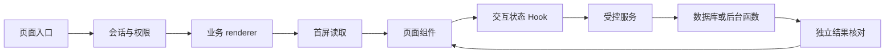

# 架构与数据流

## 先区分两个仓库

Web 仓库负责页面、交互、服务端接口和部分第三方集成。Supabase 仓库负责数据库迁移、表与函数、行级权限、Storage 策略以及 Edge Functions。两个仓库组成同一业务系统，但提交、迁移和部署分别执行。

从本文件位置可以打开 [Web 目录约定](../../reference/maintenance-handbook.md)和[后端入口](../../../../PT5-dropshipping-supabase/docs/onboarding/README.md)。

## 一个页面为什么涉及多个文件

以 `/admin/wholesale/leads` 为例：`admin` 是岗位工作台，`wholesale` 是业务，`leads` 是栏目。入口使用 `app/(workspace)/[workspace]/[business]/[section]/page.tsx`，并非每个角色复制一个页面。括号目录用于分组，不进入网址；方括号代表动态参数。

阅读顺序是：

1. `proxy.ts` 和当前会话模块处理身份与访问前提。
2. 动态 Page 核对角色配置、启用业务和业务访问能力。
3. 业务 renderer 选择首屏读取、文案命名空间和 Client。
4. Client 组合页头、列表、弹窗等展示区块。
5. `use-*` Hook 管理筛选、请求等待、详情和操作状态。
6. `lib` 中的服务读取或调用受控写入，数据库再次执行权限与业务规则。

## 首次读取与点击之后的区别

Server Component 在服务器执行，可读取服务端会话并把必要初始数据传给浏览器。带 `"use client"` 的文件可以使用交互 Hook，但它的依赖也可能进入浏览器，不能导入服务密钥模块。

首次页面读取通常使用服务端 Supabase 客户端。页面打开后的筛选与部分操作使用浏览器客户端直接访问本地或云端 Supabase；邮件、模板正文等则经过 Web 服务端接口。不要看到 `lib` 就假定代码一定在服务器执行，应检查导入链和客户端边界。

## 修改时应放在哪一层

| 修改内容 | 首先查找 |
| --- | --- |
| 文案、标题、按钮文字 | `messages` 与页面命名空间 |
| 表格、卡片、弹窗排版 | 对应业务展示组件与共享 UI |
| 筛选和等待状态 | 模块的 `use-*` 或 view-model |
| 数据字段、分页与排序 | 查询模块及数据库函数 |
| 允许谁读写 | 服务端身份、能力配置、数据库函数与 RLS |
| 金额、归属、版本与状态变化 | 领域服务和数据库业务规则 |
| 异步结果和重试 | 操作凭证、worker 与终态读回 |

拆分的目的是让一次维护能集中理解一个职责，不是让每个函数都单独成为文件。
