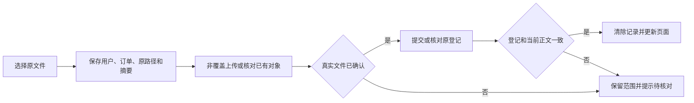

# 批发订单从页面到数据库

## 从哪里进入

管理员可从 `/admin/wholesale/orders` 打开订单列表。动态工作台页面先校验当前账号能否进入该工作台，再由批发渲染器检查此工作台是否启用订单页面。渲染器通过 `getWholesalePageData` 取得首屏数据，`WholesaleClient` 把首屏数据、角色能力和业务操作交给 `WholesaleOrdersSection`。

## 如何读和展示订单

1. `use-wholesale-order-filters.ts` 管理输入值与已应用条件。默认下单时间是上海时区含今天的 30 天，按 `ordered_at` 筛选。`order_month` 是订单归属月份，表单和筛选分别提供该字段。
2. `use-wholesale-order-page.ts` 接入公共分页状态，首屏使用服务端结果，筛选、换页和重试调用 `getWholesaleOrderPage`。核心数据库函数 `get_wholesale_order_page` 提供列表、总数和汇总。附件、修改历史、结汇记录和客户可见的负责人名称按本页订单编号补读。
3. 订单展示组件消费已投影的数据，明细标签和行值在 `wholesale-order-detail-rows.ts` 维护。关联读取失败显示局部提示。核心读取失败提供重试。
4. 管理员等有内部字段权限的岗位可以在桌面切换「全部列」。[完整表格](../../../components/dashboard/wholesale/wholesale-orders-table.tsx)为六项费用共用一份字段定义，表头和行值从同一顺序生成。调整该组费用字段时，用不同的数据库金额核对列名和单元格。手机继续通过订单卡片和详情读取。

管理员、财务和业务员的跨订单操作能力在 `lib/wholesale-role-permissions.ts` 集中定义。页面按角色和订单隐藏操作入口。数据库函数和表的访问规则决定真实可访问的行。读取结果中的 `canViewInternalFields` 控制内部视图。客户视图使用数据库裁剪后的记录，负责人通过 `get_wholesale_order_client_contacts` 按订单获取。增加客户可见字段时需要同时核对数据库投影和页面展示。

新增的服务费、税费和付款手续费属于内部派生展示，不再增加客户应付或扣减既有毛利。表单预览和数据库都逐项舍入，手续费使用已舍入的前两项；维护公式时先读[费用与客户分类提成](../../../../PT5-dropshipping-supabase/docs/onboarding/template-parameter-history.md#客户分类提成与展示费用)，再分别核对页面预览、保存后金额及客户响应裁剪。

批发聚合资料还会按当前账号和已可见对象收窄。[订单关联裁剪](../../../lib/wholesale-scope-related.ts)处理提成、订单修改记录与结汇记录，[人员和推荐裁剪](../../../lib/wholesale-people-scope.ts)处理目录、推荐关系及已授权关联人员。这一层消费已经过数据库授权的集合。

## 订单评估如何取样

订单列表内部视图在桌面表格和手机卡片上方共用一个[评估面板](../../../components/dashboard/wholesale/wholesale-order-assessment-panel.tsx)。面板把当前列表筛选交给[评估接口](../../../app/api/wholesale/order-assessment/route.ts)，包括按单号跨日期精确查找。接口校验会话和批发入口权限，[评估流程](../../../lib/wholesale-order-assessment-run.ts)限流，再用与列表相同的数据库查询核对内部字段权限和订单范围。

查询保留首批结果中的全量汇总，并追加有限订单样例。提示词列出样例中前五名客户与最多二十四笔订单。修改取样时，分别核对全量合计与样例范围，维护者可从[样例读取](../../../lib/wholesale-order-assessment-sample.ts)和[消息构造](../../../lib/wholesale-order-assessment-messages.ts)进入。

范围为空或权限拒绝时，接口会提示调整条件或检查账号权限。符合条件才登记评估运行并调用供应商。完成事件在账本确认后发送，页面在结果不完整时清除已显示的片段。页面刷新会清除本次临时显示的正文，终态和正文长度仍可从运行账本核对。

### 本地验证订单评估

先按[本地验证手册](../how-to/verification.md)启动本项目的 Web 和 Docker，并暂停计划任务。确认没有其他人同时使用这套本地 Web 的 AI 功能，再执行 `node scripts/learning/run-order-assessment-local.mjs`。脚本复用 3000 端口的 Web，在 38481 端口模拟供应商。它只在临时开发配置和探针路径均空闲时运行。结束后撤回配置，等待 Web 读回并清理探针。截图和凭证在命令记录的 `output/learning-assessment-*` 目录。

用例从管理员页面发起，核对跨日期订单、完成凭证、同一请求重复提交、空结果及不完整回复，再刷新确认没有追加记录。另用客户账号确认页面权限与接口权限一致。用例按专属编号删除订单、客户、运行记录和账号，并验证删除结果。真实供应商结果另行验收。

## 如何保存和确认

创建与编辑共用 `use-wholesale-order-draft.ts` 的未保存离开保护。`use-wholesale-order-create-submission.ts` 另负责创建请求编号和提交期间的即时互斥。同一草稿遇到断线后重试会沿用原编号。`create_wholesale_order` 根据该编号返回已建订单。主动放弃草稿后应先查订单列表，再判断是否需要重新创建。

订单现在不走修改申请或审批，但修改日志与已结算佣金仍需保留。阅读旧申请表、直接修改时间窗口或创建签名时，先对照[订单维护演进](../../../../PT5-dropshipping-supabase/docs/onboarding/workspace-order-lifecycle-history.md)。防重以创建人和请求号共同定位：同一创建人改内容会冲突，不同创建人使用同号各自独立；接口返回编号后仍须核对实际业务行。

`wholesale-order-actions.ts` 校验创建返回的订单编号、修改返回的同一订单编号，以及结汇返回的登记编号。数据库确认保存后会重读当前列表。如果重读失败，页面提示已保存、列表待更新，点击列表重试即可核对原订单。验收时独立查 `wholesale_orders` 的编号、行数和 `updated_at`，编辑另查 `wholesale_order_change_logs` 的操作者及修改前后值，再刷新页面确认一致。

直接结汇由 `use-wholesale-settlement-draft.ts` 给本次登记分配请求编号，并在同一浏览器标签页按账号及订单暂存原金额和日期。回执丢失时保留原草稿，再次保存用原编号核对。即使刷新后原金额大于剩余可结汇金额，仍可以重试原草稿。数据库会在订单锁内确认记录属于当前操作者，且金额和日期匹配。新建的一笔同金额、同日期结汇使用新编号。成功需取得 `wholesale_order_settlements.id`，并独立核对行数、原币金额、汇率、人民币金额和订单状态。

## 常见维护入口

日期、计入月份和本月已分配统计的原SQL按[后端订单/财务练习](../../../../PT5-dropshipping-supabase/docs/onboarding/order-finance-sql-tests.md)准备专属夹具。数据库下单时间、计入月和分配创建时刻各有明确口径，双时区SQL检查不替代下面的真实页面验证。

阅读采购认领与早期日期分页时，使用[认领与日期历史指南](../../../../PT5-dropshipping-supabase/docs/onboarding/claims-and-date-history.md)。认领已由后续迁移取消；当前订单和日期修改按下列入口定位。

| 要改的内容 | 从哪里开始 |
| --- | --- |
| 日期、关键词和归属月份 | `use-wholesale-order-filters.ts`、`lib/order-date-range.ts` 与数据库分页函数 |
| 表单费用预览 | `use-wholesale-order-fees.ts`、`lib/wholesale-order-fees.ts`；实际费用以订单保存值为准 |
| 详情字段与文案 | `wholesale-order-detail-rows.ts`、`WholesaleBusiness.ordersUi.detailFields`；分别核对客户和内部字段 |
| 桌面全部列 | `wholesale-orders-table.tsx` 的费用列定义；`wholesale-ui.tsx` 提供共享表格滚动与固定表头 |
| 保存提示和列表恢复 | `wholesale-order-actions.ts`、`use-wholesale-order-page.ts` 与 `WholesaleBusiness.ordersUi.writeFeedback` |
| 直接结汇与断线重试 | `use-wholesale-settlement-draft.ts`、`wholesale-order-rate-dialogs.tsx`、数据库的 `add_wholesale_order_settlement` |
| 附件上传与回执核对 | `lib/wholesale-order-list-upload.ts` 上传对象，`lib/wholesale-order-list-registration.ts` 登记和读回，`lib/wholesale-order-list-attachments.ts` 下载与删除 |

附件先上传到私有 bucket，再通过数据库函数按订单批量登记。开始写入前，当前标签页按用户和订单保存原文件名、大小、摘要及准确路径。正常回包、回包丢失和登记后的最终核对都需要真实文件凭证。数据库明确拒绝且没有原登记时才能限定清理；重复约束、权限变化、空查询或读取错误不代表可以删除原对象。验收须核对登记编号、对象路径和文件内容，删除后再确认两侧均为空。

### 上传结果不明时怎样恢复

同一标签页跨页或刷新后，先查看已上传列表。需要重试时重新选择同一批原文件；选择器顺序可以改变，程序按正文摘要配回原路径。已确认的对象不会重传，新的写入仍使用`upsert:false`。原批次登记完成后会先结清旧核对记录，随后才能处理另一批文件。当前记录只保留到标签页会话结束；它不保存文件正文或登录凭证，也不决定权限。

| 当前阶段 | 维护规则与入口 |
| --- | --- |
| `uploading` | `wholesale-order-list-upload-journal.ts`记录范围与摘要；`wholesale-order-list-upload-object.ts`读回真实对象。未确认时保留整批记录，重试只使用原路径；同名但正文不同不能作为原文件。 |
| `registering` | `wholesale-order-list-registration.ts`按原订单、桶和路径查询。零行、部分行或错误仍是未确认，不自动再次登记。记录完整后继续核对上传者、元数据和当前正文。 |
| 完整完成 | `wholesale-order-list-upload.ts`在登记及文件均确认后清除本次记录。调用方再更新页面；未确认错误带`partial_failed`标识，动作运行器返回未完成并显示核对指引。 |

正文核对使用当前SDK的`no-store`读取，避免把旧浏览器副本当作当前结果。标签页记录损坏、临时存储被禁用或持续查询零行时，不要清空整站数据、手动改登记或重复选新文件；先保留原文件，由管理员按准确订单／上传者路径独立核对。关闭整个标签页后的自动恢复不属于这份标签页记录的能力，不能把记录丢失当作服务端没有写入。

专项入口为`npm run test:learning:browser -- wholesale-order-attachment-interruption --grep "上传响应丢失 zh/1440" --max-failures=1`。完整相关回归使用`npm run test:learning:browser -- wholesale-order-attachment-interruption wholesale-order-attachments --timeout=180000 --max-failures=1`，复用现有Web，账号和两个订单均为本次专属。第二张订单用于保护未操作数据；部分上传场景使用同一订单的两个文件，并逆序重选。最终凭证、截图、原表摘要和限定回收各自保存，不能只凭提示或成功回包通过。

孤立对象的数据库可见性按[附件SQL维护](../../../../PT5-dropshipping-supabase/docs/onboarding/attachment-visibility-sql.md)核对精确对象ID/路径、真实上传者和财务身份。同名旧对象不能当作本次成功凭证，其他账号自己的对象也不能算本次越权；该SQL只准备对象登记，文件字节和删除API仍按页面链路验收。

删除先读回准确的登记和对象路径。文件仍存在时通过 Storage 删除，再从对象目录确认原路径消失。文件已移除而登记仍在时，刷新后可再次点击删除以续办登记。对象目录读取失败时停下，避免根据网络错误误删登记。客户从 `/client/wholesale/orders` 读取本人订单和可见附件。管理按钮由前端隐藏，实际读写权限由数据库和 Storage 策略分别控制。

维护附件授权时依次检查三层：岗位与业务栏目决定页面入口，`current_user_can_manage_wholesale_order_list` 决定管理能力，附件登记和 `storage.objects` 的各自策略决定记录及文件是否可读。可见的登记不等于签名成功，签名成功也不等于下载内容正确。管理员、财务、业务员具备管理能力；经理、运营可读取但不能管理；客户限本人订单；招聘和推广还受当前栏目和业务启用范围限制。测试只为本次随机内部账号显式开通批发业务，不修改全局规则。

`wholesale-order-client-scope.spec.ts` 固定检查八岗位、中英文及1440/390px共32种页面组合。内部精简表格应先点击“详情”再查附件；客户桌面可直接下载。每个岗位使用两张专属订单，业务员从真实页面上传，独立查询核对登记编号、行版本、Storage对象及文件字节SHA，再以该岗位真实登录发起签名和下载。客户的下载按钮还会请求另一张真实存在的订单附件，检查拒绝提示及没有下载。认证值、下载签名只在内存中使用。只读岗位的登记删除应为零行，刷新后版本保持一致。

初次维护可先执行 `npm run test:learning:browser -- wholesale-order-client-scope --grep "岗位 client" --max-failures=1`，再去掉 `--grep` 运行完整矩阵。套件只回收本次两个订单前缀及其随机账号；原固定账号套件和其他上传／删除中断场景分别验收，不能用这组读取矩阵替代。

在本地 Web 与 Docker 正常时运行 `npm run test:learning:browser -- wholesale-order-create-recovery dashboard-dialog-layers wholesale-order-attachments wholesale-order-client-scope wholesale-order-settlement-recovery`。测试拥有专属账号和客户，按编号清理。费用预览可用 `node --test scripts/wholesale-order-fees.test.mjs` 验证，回执规则可用 `npm run test:operation-receipts` 验证。[订单核心验证](../reference/verification-2026-11-05-wholesale-order-core.md) · [上传回执验证](../reference/verification-2026-11-05-wholesale-order-attachments.md) · [删除中断与客户权限验证](../reference/verification-2026-11-05-wholesale-order-delete-scope.md) · [直接结汇验证](../reference/verification-2026-11-05-wholesale-order-settlement.md)

桌面费用列可单独运行 `npm run test:learning:browser -- wholesale-order-full-table`。用例把每个中英文表头对应的金额和独立数据库结果比较，并检查页面访问前后记录版本一致。

订单内部列、账号列权/行权与收件原子事务的演进见[订单、账号与邮件边界](../../../../PT5-dropshipping-supabase/docs/onboarding/order-mail-boundary-history.md)，其中区分早期游标与当前编号页。

原SQL的[创建、联系人与编号分页手册](../../../../PT5-dropshipping-supabase/docs/onboarding/order-finance-sql-tests.md#创建联系人与编号分页)使用专属四角色/两客户和120张合成订单：创建按真实记录与请求编号核对，联系人检查恢复后的正例及撤权影响行数，客户分页对照管理员独立查出的60张关联订单。它们不依赖原受限浏览器登录入口；SQL断言通过不代表页面、双连接竞争或真实Auth验收。

[日常改单与历史财务读回](../../../../PT5-dropshipping-supabase/docs/onboarding/order-edit-financial-readback.md)分开订单写入、旧流程退出结构合同与审计查询。新客户提成按服务费基准，已结算提成日常冻结；财务读回必须有完成审计和完整快照，不能只看查询退出0。原SQL与页面版本冲突入口的验证范围分别记录。
